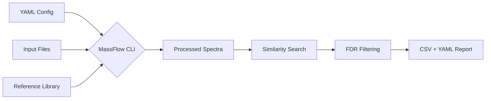

# Quickstart Guide

This guide walks you through your first end-to-end tandem mass spectrometry (MS/MS) annotation run using MassFlow's stable CLI workflow.

---

## Workflow at a Glance



---

## 0. Try It Instantly with Tutorial Data

If you want to evaluate MassFlow right now without hunting down MS/MS files, use the built-in tutorial generator:

```shell
uv run massflow tutorial
```

This creates a `tutorial/` directory with everything you need: a reference library, experimental queries, and a pre-configured YAML config. Then follow the printed next-steps commands to build the database and run an annotation — all in under a minute.

For a complete walkthrough, see the [Usage Guide](../user-guide/usage.md).

---

## 1. Choose Your Inputs

You need:
1.  **One experimental file** (e.g., `experiment.mzML`).
2.  **One reference library** (e.g., `library.msp` or an existing SQLite `.db` library).

!!! warning "Vendor Raw Formats"
    MassFlow core pipeline directly supports open formats. It **does not** implicitly convert vendor raw formats (like `.raw`, `.d`, `.wiff`, `.lcd`) during the annotation run.

    You must pre-convert vendor files to `.mzML` prior to running MassFlow. We provide a convenient wrapper command to do this using ProteoWizard's MSConvert (if installed on your system):
    ```shell
    uv run massflow convert --input data/raw/ --output data/experiments/
    ```

**Supported user-facing input formats:**
*   `.mzML`
*   `.mzXML`
*   `.MGF`
*   `.MSP`
*   `.db` / `.sqlite` (MassFlow native databases)

!!! tip "Format detection and mixed-format directories"
    MassFlow infers each file's format from its extension. Leave `format` unset (`null`) when your `input_path` is a directory that contains **more than one** format — a fixed `format` hint is applied to *every* file and will make the others fail to load. Set `format` only when you are pointing at a single file of a known format.

---

## 2. Create a Starter Configuration

MassFlow is a "config-first" toolkit. Rather than passing dozens of flags into the terminal, you manage your analysis via a single YAML file.

Generate a canonical starter configuration:

```shell
uv run massflow init --output massflow_config.yaml

# Alternatively, use the interactive wizard for a guided setup:
uv run massflow config-wizard
```

Open `massflow_config.yaml` in your favorite text editor. It is pre-populated with standard `matchms` processing filters and the classical `cosine` similarity algorithm.

Update the `input` block to point to your files:

```yaml title="massflow_config.yaml"
project:
  name: "Standard_Annotation_Project"
  output_directory: "results/standard_analysis"

input:
  # Set these paths relative to this configuration file.
  input_path: "data/experiments/experiment.mzML"
  library_path: "data/libraries/library.msp"
  # Leave null for per-file extension inference. A fixed hint applies to every
  # file and is unsuitable for mixed-format directories.
  format: null

processing:
  # Standard filters (clean_metadata, filter_min_peaks, etc.)
  # ...

similarity:
  # Classical algorithm
  algorithm: "cosine"
  ms1_tolerance: 0.02
  ms2_tolerance: 0.02
  min_score: 0.6
  min_matched_peaks: 3
  fdr_threshold: 0.05

export:
  format: "csv"
```

!!! tip "Directories instead of files"
    If you have a batch of experimental files, you can point `input_path` to a folder instead of a single file. MassFlow will recursively process all supported spectral files in that folder in parallel. Leave `format: null` for a mixed-format folder.

### 2b. Raw vs curated reference libraries

You can point `library_path` at a raw library file (`.msp`/`.mgf`/`.mzML`) or at a curated MassFlow store (`.db`). Curation is **required** when a raw library declares chemical structures that its own precursor m/z contradicts:

* A spectrum that declares a `FORMULA`/SMILES/InChI whose precursor m/z deviates from the theoretical value by more than **5 ppm** fails MassFlow's strict physical-integrity gate.
* In `annotate`, such an entry **aborts the run** — MassFlow never silently searches a shrunken reference pool.
* In `db build`, such entries are **quarantined** (logged, not silently dropped) and the remaining spectra are stored.

Build the store once, then point `library_path` at it:

```shell
uv run massflow db build \
  --input data/libraries/my_library.msp \
  --output results/my_library.db \
  --config massflow_config.yaml \
  --category library
```

Then set `library_path: results/my_library.db` in your config. See [Data Requirements](../user-guide/data-requirements.md) for the full metadata contract.

---

## 3. Check compatibility, then run the annotation

Before a long run, ask MassFlow what it can establish about your query and library. Precursor eligibility does **not** guarantee an MS2 match or identification:

```shell
uv run massflow preflight --config massflow_config.yaml
```

`preflight` reads the inputs without scoring and reports library size, precursor coverage, ionization modes, MS2 peak counts, and counts after applicable precursor/adduct/RT eligibility filters. It distinguishes verified gates from heuristic precursor coverage for engines that do not enforce an MS1 window. It is **advisory** — it never changes your parameters and never blocks the run.

```text
MassFlow Preflight
─────────────────────────────────────────────

Reference spectra:      1,166
Precursor m/z range:    102.0560 - 1207.1500
Ionization modes:       negative (614), positive (552)

Spectra passed input validation: 5,331
Retained for search:              5,331
Rejected/dropped:                   2,495 (input validation 2,495; processing 0)
Precursor window:                  ±0.02 Da
Queries with <3 MS2 peaks: 2,425 (45%)
Queries with eligible precursor/mode/RT candidate: 256 (4.8%)
Pairs within precursor window: 1,212
Pairs after adduct-mode / RT filters: 1,212

Assessment:
  (verified) Small reference library: 1166 usable spectra (below the ~2000
    recommendation). This is a factual size limit on the available reference
    candidates.
  (likely) Target-decoy FDR calibration may be statistically weak for a library
    this small; the exact uncertainty depends on the run's score distribution
    and decoy competitions.
  (verified) 2495 query spectra were rejected/dropped (input validation 2495;
    processing 0). These spectra were not searched.
  (verified) 2425 of 5331 retained query spectra (45%) contain fewer than
    min_matched_peaks=3 raw MS2 peaks and cannot meet the configured matched-peak
    minimum in the classical cosine engines.
  (verified) Limited reference-library coverage: only 256 of 5331 retained query
    spectra (4.8%) have at least one verified cosine-eligible reference after
    known adduct-mode and retention-time constraints.
  -> 256/5331 query spectra have a precursor-window candidate after known
    adduct/RT constraints.

Recommendations:
  - For calibrated identifications, use a larger relevant library. Do not relax
    the FDR threshold just to obtain hits; treat an empty result as inconclusive
    when calibration is underpowered.
  - Review the MS2 peak counts; check the input acquisition and any
    `filter_min_peaks` / `filter_by_intensity` settings.
  - Consider additional reference libraries.
  - Verify precursor / adduct assumptions and the ms1_tolerance.

─────────────────────────────────────────────
Advisory only. Parameters are not changed and the run is not blocked.
```

Findings are tagged `verified` (a configured search predicate or measured count establishes them) or `likely` (a statistical limitation or heuristic). Eligible precursor candidates are not guaranteed fragment matches; score, matched-peak, adduct, RT, and FDR filters still apply.

Then execute the core workflow by passing your configuration to the CLI:

```shell
uv run massflow annotate --config massflow_config.yaml
```

MassFlow will:
1. Load the YAML config and validate your file paths.
2. Ingest and process the reference library through the defined metadata and peak filters.
3. Discover your experimental queries and process them identically.
4. Score queries against chunked reference libraries.
5. Compute a Target-Decoy False Discovery Rate (FDR).
6. Keep retained matches and export the results.

---

## 4. Interactive 'Watch' Mode

If you are actively tweaking your noise thresholds or similarity parameters, you don't need to manually re-run the `annotate` command every time. MassFlow provides an interactive live-reloading UI:

```shell
uv run massflow watch --config massflow_config.yaml
```

This launches a real-time Rich table in your terminal. Whenever you save changes to your files or configuration, MassFlow will automatically re-run the pipeline and update the results preview on your screen.

---

## 5. Check the Results

MassFlow writes one CSV report per experimental input file directly into `project.output_directory`.

If your input file was named `experiment.mzML`, expect two outputs:
1. `results/standard_analysis/experiment_results.csv`
2. `results/standard_analysis/experiment_results.report.yaml`

### The CSV Result Table
The CSV contains the actual annotation hits, including the computed `score`, `matched_peaks`, and an automated `Annotation_Status` tag (e.g., `Matched`, `Putative`, or `Unknown`).

!!! note "Unmatched Queries"
    The CSV includes matched *and* unmatched query spectra. If a query spectrum has no retained hit after score and FDR filtering, the row is still exported, but the reference-specific columns are left blank. This allows you to confirm that the input was successfully processed.

!!! tip "A run with zero hits is a valid outcome — here is how to read it"
    If every row is `Unknown`, MassFlow separates four causes: (1) queries were **rejected while loading** (empty peaks / missing precursor / 5 ppm gate), (2) **no library coverage** (no library precursor within `ms1_tolerance`), (3) **candidates rejected** by `min_score` / `min_matched_peaks`, or (4) **filtered statistically** by FDR at a strict threshold on a small library. Run `massflow preflight` for (1)–(3) and check the per-file `.report.yaml` (`spectra_loaded`, `spectra_rejected`, `fdr_summary`, warnings) for the rest. See [Results & Zero-Hit Diagnosis](../user-guide/results.md).

```csv title="experiment_results.csv (Simplified No-Match Example)"
query_id,query_precursor_mz,reference_id,reference_name,score,Annotation_Status
example_query_0,304.0,,,,Unknown
```

### The Provenance Sidecar Report
The sidecar report (`.report.yaml`) acts as a hard link between your CSV results and the run conditions that produced it. It captures:

- When the analysis was run.
- Which query file and library file were used.
- The path to the original `massflow_config.yaml`.
- The exact parsed configurations (`processing`, `similarity`, `workflow`) that were applied.

This ensures you can always reproduce how a specific CSV was generated months later.
